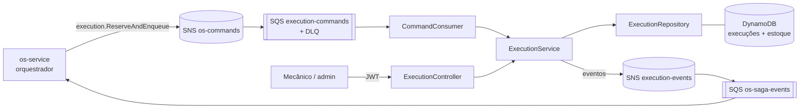

# auto-repair-execution-service

Microsserviço de **execução e produção**. Gerencia a fila de serviços da oficina e
o estoque de peças, e avisa o `os-service` quando um reparo termina. Participa da
saga orquestrada (ver ADR-004 no repositório da API).

| Entrega | Onde |
|---|---|
| Código-fonte | `src/` |
| Dockerfile | [`Dockerfile`](Dockerfile), [`docker-compose.yml`](docker-compose.yml) |
| Manifestos Kubernetes | [`k8s/`](k8s) (aplicados pelo pipeline) |
| Pipeline CI/CD | [`.github/workflows/ci-cd.yml`](.github/workflows/ci-cd.yml) |
| Cobertura de testes | [seção Qualidade](#qualidade-e-cobertura-de-testes) |
| Arquitetura | [seção Arquitetura](#arquitetura) |
| API | Swagger em `/docs` · Postman (fluxo completo da saga) em [`docs/postman/`](docs/postman) |

## Arquitetura



| Camada | Arquivos | Responsabilidade |
|---|---|---|
| Entrada assíncrona | `messaging/command.consumer.ts` | Lê `ReserveAndEnqueue`, apaga só após sucesso |
| Entrada HTTP | `execution/execution.controller.ts` | Fila, avanço de etapas e estoque (somente `admin`) |
| Domínio | `execution/execution.service.ts` | Regras de transição e publicação de eventos |
| Persistência | `execution/execution.repository.ts` | Tabela única DynamoDB, transação de reserva, fila FIFO |
| Transversal | `auth/`, `logging/` | JWT HS256 + papéis; logs JSON com `correlation_id` |

**Papel na saga:** participante. Se faltar estoque, publica `StockUnavailable` sem
gravar nada (transação abortada) e o orquestrador estorna o pagamento.

## Banco de dados: DynamoDB (NoSQL)
Usa uma tabela única, com chave primária `pk`/`sk`:

| Item | `pk` | `sk` | Atributos |
|---|---|---|---|
| Execução | `EXEC#{orderId}` | `EXEC` | `status`, `paymentId`, `parts[]`, `history[]`, `gsi1pk`, `gsi1sk` |
| Estoque | `PART#{partId}` | `STOCK` | `quantity` |

- **Fila FIFO:** o índice `gsi1` (`gsi1pk="QUEUE"`, `gsi1sk="{queuedAt}#{orderId}"`) é esparso. Ao finalizar, a execução remove essas chaves e sai da fila.
- **Reserva atômica:** uma única `TransactWriteItems` cria a execução (condição `attribute_not_exists`) e baixa o estoque de cada peça (condição `quantity >= :q`). Ou tudo é gravado, ou nada.
- **Por que DynamoDB:**
  - o histórico de diagnóstico e reparo é semiestruturado;
  - o acesso é sempre por chave ou pela fila;
  - a escrita condicional resolve a concorrência no estoque sem locks.

## Contrato de mensageria

| Direção | Tipo | Payload |
|---|---|---|
| ⬅ comando | `execution.ReserveAndEnqueue` | `{ orderId, paymentId, parts[{partId, quantity}] }` |
| ➡ evento | `ExecutionQueued` | `{ orderId }` |
| ➡ evento | `StockUnavailable` | `{ orderId, paymentId }`: o orquestrador estorna o pagamento e cancela a OS |
| ➡ evento | `ExecutionFinished` | `{ orderId }` |

**Idempotência:** o SQS pode entregar a mesma mensagem mais de uma vez.
- Se o comando chegar repetido, a transação é recusada como `DUPLICATE`; o estoque não é baixado de novo e `ExecutionQueued` é republicado.
- Chamar `finish` de novo republica `ExecutionFinished`, cobrindo o caso de a primeira publicação ter falhado.

## Endpoints
Documentação interativa no Swagger: `http://localhost:3002/docs`. Todas as rotas
abaixo, exceto `/health`, exigem JWT com perfil `admin`.

| Método | Rota | Descrição |
|---|---|---|
| GET | `/executions` | Fila ativa em ordem de chegada |
| GET | `/executions/:orderId` | Execução com o histórico |
| POST | `/executions/:orderId/diagnosis` | `QUEUED → IN_DIAGNOSIS` (`{ note? }`) |
| POST | `/executions/:orderId/repair` | `IN_DIAGNOSIS → IN_REPAIR` |
| POST | `/executions/:orderId/finish` | `IN_REPAIR → FINISHED` e publica `ExecutionFinished` |
| GET/PUT | `/stock/:partId` | Consulta ou define o estoque (`{ quantity }`) |
| GET | `/health` | |

As transições usam atualização condicional (`#s = :from`). Uma alteração concorrente retorna `409`.

## Executar
```bash
cp .env.example .env
docker compose up -d && npm ci && npm run db:init && npm run start:dev
```

## Qualidade e cobertura de testes

```bash
npm test           # unitários
npm run test:cov   # cobertura (falha abaixo de 80%)
```

**Cobertura atual** (76 testes):

| Statements | Branches | Functions | Lines |
|---|---|---|---|
| 100% | 95,62% | 100% | 100% |

**Evidências:** cada execução do pipeline publica a tabela de cobertura no *Job
Summary* e o relatório HTML no artefato `coverage-report`; análise e quality gate
no SonarQube.

<!-- Substitua pelos prints/links da sua execução:


-->

## CI/CD

`lint → build → testes (cobertura ≥ 80%) → SonarQube (quality gate) → imagem (GHCR) → deploy no EKS`

- `homolog`: deploy automático · `main` (produção): aprovação manual no GitHub Environment.
- Branch `main` protegida: exige PR e o check `Build, Test & Quality`.
- Secrets: `SONAR_TOKEN`, `SONAR_HOST_URL`, `AWS_DEPLOY_ROLE_ARN`.

## Kubernetes

| Arquivo | Conteúdo |
|---|---|
| [`k8s/00-config.yaml`](k8s/00-config.yaml) | ServiceAccount (IRSA com acesso à tabela), ConfigMap, ExternalSecret (JWT), Service |
| [`k8s/10-deployment.yaml`](k8s/10-deployment.yaml) | Deployment (probes, limites, Datadog) e HPA (2–5 réplicas) |

O pipeline preenche `${ACCOUNT_ID}`, `${ENV}` e `${IMAGE}` com `envsubst` e aplica
os manifestos. A tabela DynamoDB, filas, tópicos e roles IAM são criados pelo
Terraform nos repositórios de infra.
